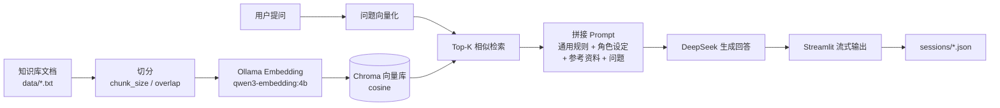

# python-rag-lyra

一个基于 **RAG（检索增强生成）** 的角色扮演对话助手：把小说文本切分、向量化后存入本地向量库，聊天时先检索与问题最相关的原文片段，再交给大模型模仿原作文风进行角色扮演。

以《背景小马》中的角色 **天琴心弦** 为默认示例，角色设定保存在 [data/tianqin.md](data/tianqin.md)，可替换成任意角色与任意知识库文本。

系统提示词分为两层：[data/default_prompt.md](data/default_prompt.md) 存放与角色无关的通用规则，[data/tianqin.md](data/tianqin.md) 存放具体人设，运行时拼接后发送给模型。

---

## 功能特性

- **本地向量化**：通过 Ollama 调用 Embedding 模型，文本不出本机
- **三种切片策略**：段落合并 + 长段句切、按空行切分、固定长度切分
- **向量检索**：Chroma 持久化到 `data/chroma_db`，余弦距离，可调 `top_k`
- **角色扮演**：检索原文注入 Prompt，让模型模仿资料的文风与语气
- **提示词分层**：通用规则与角色设定分开存放，侧边栏可实时编辑角色提示词并一键恢复默认
- **流式对话**：Streamlit 网页界面，逐字输出
- **会话管理**：新建 / 切换 / 删除会话，历史自动保存为 JSON
- **双入口**：命令行菜单 或 Streamlit 网页

---

## 工作原理



1. **建库**：读取文档 → 按所选策略切块 → 批量调用 Ollama Embedding → 写入 Chroma（附 `source`、`chunk_index` 元数据）
2. **检索**：用户问题向量化 → 在 Chroma 中取余弦距离最近的 `top_k` 个片段
3. **生成**：把片段编号后拼进 Prompt，连同两层系统提示词（通用规则 + 角色设定）一起发送给 DeepSeek
4. **保存**：对话记录写入 `sessions/`，可随时恢复

---

## 技术栈

| 组件 | 用途 |
| --- | --- |
| Python 3.14 + [uv](https://github.com/astral-sh/uv) | 运行环境与依赖管理 |
| [ChromaDB](https://www.trychroma.com/) | 本地持久化向量数据库（HNSW + 余弦距离） |
| [Ollama](https://ollama.com/) | 本地 Embedding 服务（默认 `qwen3-embedding:4b`） |
| [DeepSeek](https://www.deepseek.com/) | 对话生成（OpenAI 兼容接口） |
| [Streamlit](https://streamlit.io/) | 网页聊天界面 |
| tqdm | 向量化进度条 |

---

## 目录结构

```text
python_rag_lyra/
├── data/
│   ├── default_prompt.md     # 通用系统提示词：回答规则（随仓库提供）
│   ├── tianqin.md            # 角色设定（随仓库提供）
│   └── BCPONY.txt            # 知识库原文（需自备）
├── sessions/                 # 对话历史，运行时自动生成
├── src/python_rag_lyra/
│   ├── rag.py                # 切分 → 向量化 → 写入 Chroma
│   ├── embedding.py          # Ollama Embedding 客户端
│   ├── session.py            # 检索 + Prompt 拼接 + 调用 DeepSeek
│   ├── app.py                # Streamlit 聊天界面
│   └── main.py               # 命令行菜单入口
├── .env_example              # 配置模板
├── pyproject.toml
└── uv.lock
```

---

## 快速开始

### 1. 环境要求

- Python 3.14+
- [uv](https://docs.astral.sh/uv/getting-started/installation/)
- 本地已安装并启动 [Ollama](https://ollama.com/download)
- 一个 DeepSeek API Key（[申请地址](https://platform.deepseek.com/)）

### 2. 拉取 Embedding 模型

```bash
ollama pull qwen3-embedding:4b
ollama list   # 确认模型已就绪
```

### 3. 安装依赖

```bash
git clone https://github.com/Suran-g/python_rag_lyra.git
cd python_rag_lyra
uv sync
```

### 4. 配置环境变量

```bash
cp .env_example .env
```

编辑 `.env`，至少填入 API Key：

```dotenv
DEEPSEEK_API_KEY="sk-xxxxxxxx"
```

完整配置项：

| 变量 | 说明 | 默认示例 |
| --- | --- | --- |
| `DEEPSEEK_API_KEY` | DeepSeek API Key（**必填**） | — |
| `DEEPSEEK_BASE_URL` | 对话接口地址 | `https://api.deepseek.com` |
| `DEEPSEEK_MODEL` | 对话模型 | `deepseek-chat` |
| `OLLAMA_HOST` | Ollama 服务地址 | `http://localhost:11434` |
| `EMBED_MODEL` | Embedding 模型 | `qwen3-embedding:4b` |
| `CHROMA_PATH` | 向量库存储路径 | `data/chroma_db` |
| `COLLECTION_NAME` | 集合名称 | `doraemon` |
| `DEFAULT_PROMPT_PATH` | 通用系统提示词文件路径 | `data/default_prompt.md` |
| `SYSTEM_PROMPT_PATH` | 角色设定文件路径 | `data/tianqin.md` |

### 5. 准备知识库文本

仓库**不包含**小说原文。把你要检索的文本放到 `data/` 下，并重命名
例如：

```text
data/BCPONY.txt
```


### 6. 构建知识库并启动

```bash
uv run python -m python_rag_lyra.main
```

按菜单提示操作：

```text
===== 知识库助手 =====
1. 构建 / 重建知识库
2. 提问
3. 查看库状态
0. 退出
=====================
```

选择 `1` 后可以指定切块方式：

| 编号 | 策略 | 参数 | 说明 |
| --- | --- | --- | --- |
| `1` | 段落合并 + 长段句切 | `chunk_size=500`, `overlap=80` | 优先按空行合并段落，超长段落再按中文句号等切分（推荐） |
| `2` | 按空行切分 | 无 | 保留原段落，块大小不固定 |
| `3` | 固定长度切分 | `chunk_size=200`, `overlap=80` | 按字符数硬切，可能有句子被截断 |

切块完成后，选择 `2` 启动网页界面；也可以直接运行：

```bash
uv run streamlit run src/python_rag_lyra/app.py
```

---

## 提示词配置

系统提示词由**通用规则**和**角色设定**两层拼接而成，模板本身不包含对话历史：

| 文件 | 环境变量 | 作用 |
| --- | --- | --- |
| `data/default_prompt.md` | `DEFAULT_PROMPT_PATH` | 与角色无关的回答规则：参考资料、模仿文风、不暴露系统词汇等 |
| `data/tianqin.md` | `SYSTEM_PROMPT_PATH` | 具体人设：身份、核心原则、回答风格 |

拼接顺序（见 `app.py`）：

```python
system_prompt = (
    f"{DEFAULT_SYSTEM_PROMPT}\n\n"   # data/default_prompt.md
    f"{role}\n\n"                    # data/tianqin.md，昵称替换后
    f"【当前扮演】你的名字是「{nick}」，回答中以此自称。"
)
```

- 角色设定中的所有「天琴心弦」会被替换成侧边栏填写的昵称
- 侧边栏「角色提示词」文本框可直接修改人设，只影响当前会话，不改动原文件
- 「恢复默认角色提示词」会重新载入 `data/tianqin.md`
- 当前会话使用的角色提示词会随对话一起保存到 `sessions/*.json`
- 换角色时一般只需替换 `data/tianqin.md`；通用的行为约束放在 `default_prompt.md`
- 两个文件均按 UTF-8 读取，修改后刷新页面即可生效

---

## 参数说明

### 检索参数

| 参数 | 位置 | 当前默认值 | 说明 |
| --- | --- | --- | --- |
| `Top_K` | `session.__init__()` | `25` | 实例级检索片段数；`retrieve()` 不传 `top_k` 时使用 |
| `top_k` | `session.ask()` | `3` | 命令行 `ask()` 单独调用时使用（当前菜单入口未调用） |
| `top_k` | `app.py` 侧边栏 | `25`（可调 25~100） | 网页版每次注入的片段数，经 `context_chunks(top_k=...)` 传入 |
| `hnsw:space` | `rag.get_collection()` | `cosine` | 距离度量，建库时固定 |

> `top_k` 越大召回越全，但无关片段也会混入 Prompt 并挤占上下文长度。网页版滑杆范围固定为 25~100，默认 25；命令行 `ask()` 默认 3，更省 token。

### 生成参数

| 参数 | `session.py` | `app.py` | 说明 |
| --- | --- | --- | --- |
| `model` | `DEEPSEEK_MODEL` | `DEEPSEEK_MODEL` | 生成模型（读取 `.env`） |
| `temperature` | `2.0` | `1.0`（可调 0.2~2.0） | 随机性，角色扮演可偏高 |
| `top_p` | `1.0` | `1.0`（可调 0.1~1.0） | 核采样 |
| `max_tokens` | `1000` | `512` | 回答长度上限 |
| `stream` | `False` | `True` | 流式输出 |
| `thinking` | — | `none`（关闭） | DeepSeek 思考模式；侧边栏可选 `none`/`low`/`high`/`max`，并以 `reasoning_effort` 透传 |

### 切片参数

`rag` 构造函数支持自定义：

```python
rag("data/BCPONY.txt", chunk_size=500, overlap=80, chunks_model=1)
```

| 参数 | 说明 |
| --- | --- |
| `chunk_size` | 目标块大小（字符数） |
| `overlap` | 相邻块重叠字符数，防止答案被切断 |
| `chunks_model` | 切分策略：`1` 段落合并 / `2` 空行 / `3` 固定长度 |

---

## 数据与隐私

- `.env`、`sessions/`、`data/` 下的文档均已在 [.gitignore](.gitignore) 中排除，不会被提交
- Embedding 在本地 Ollama 完成，原文不会上传
- 只有检索到的片段与对话内容会发送给 DeepSeek
- 知识库原文版权归原作者所有，本项目仅用于学习与个人用途

---

## 其他

- 角色设定与示例文本来源于同人作品《背景小马》，版权归原作者所有
